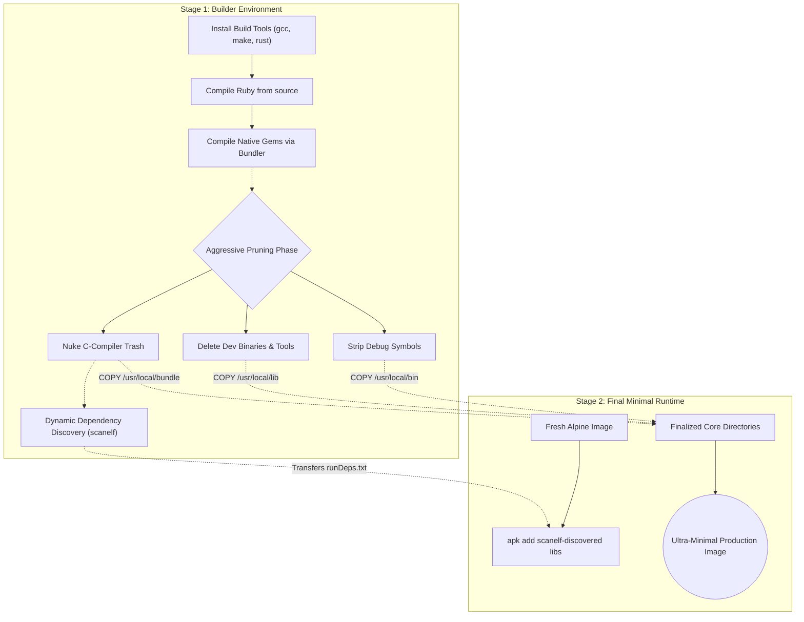

# Ruby Docker Image Minimization Guide

This document is a comprehensive manual for aggressively optimizing and minimizing a Ruby production Docker image (such
as an Alpine-based Nginx/Passenger container), achieving the smallest possible attack surface and storage footprint.

---

## 1. The Multi-Stage Build Architecture

The golden rule of Docker minimization is **never ship your build environment to production**. Compiling Ruby or native
gems (like `nokogiri` or `passenger`) from source requires hundreds of megabytes of C-compilers, Rust toolchains, raw
C-headers, and intermediate object files.

By utilizing a **Multi-Stage Build**, you create an ephemeral "Builder" stage where all the messy compilation occurs,
and then surgically copy _only_ the finalized execution engine to a completely fresh "Final" stage.

### Architecture Diagram



### The System Dependencies Trap (`scanelf`)

A common mistake is copying compiled binaries to a fresh stage without copying the Alpine system libraries they linked
against (e.g., `libssl.so`, `libyaml.so`). To seamlessly bridge this gap without guessing, we run `scanelf` in the
Builder stage to dynamically crawl every compiled Ruby binary and generate an exact text list of Alpine packages to
install in the final stage.

#### How Alpine `so:` Virtual Providers Work

Unlike Ubuntu/Debian (`apt-get`), which often installs hundreds of megabytes of documentation and GUI trash alongside
libraries, Alpine Linux enforces a strict **Split-Package Policy**. Documentation is relegated to `-doc` packages, and
headers to `-dev` packages.

When `scanelf` generates a list of required libraries prefixed with `so:` (e.g., `so:libssl.so.3`), `apk` dynamically
searches its registry for exactly which Alpine package provides that precise file, and installs _only_ that stripped
package. This completely eliminates the need to hardcode brittle package names (like `openssl` vs `libcrypto3`) inside
your Dockerfile.

---

## 2. Anatomy of the Target Directories

When mapping files from the Builder to the Final stage, you only care about three directories. Here is what they contain
and what you can safely eliminate.

### `A. /usr/local/bin/` (The Interfaces)

This directory holds the CLI binaries you execute. In modern production deployments, almost everything here aside from
the core interpreter is dead-weight developer tooling.

- **🟢 Keep:** `ruby`, `bundle`, `bundler` (Strictly required for Passenger/Puma).
- **🔴 Delete:** `irb`, `gem`, `rdoc`, `ri`, `erb`, `minitest`, `test-unit`, `typeprof`.
- **⚠️ Conditional:** `rake` (Only keep if your `ENTRYPOINT` script literally invokes `rake db:migrate`).

### `B. /usr/local/lib/` (The Engine)

This directory contains the actual brains of the Ruby VM and the standard library.

- **🟢 Keep (`libruby.so.X.X`):** The massive core Virtual Machine engine. If deleted, the `/usr/local/bin/ruby` wrapper
  will crash immediately.
- **🟢 Keep (`ruby/`):** The standard library implementation logic (`json`, `net/http`, `fileutils`).
- **🔴 Delete (`pkgconfig/`):** A folder of `.pc` files used by C-compilers to read linker flags. Completely useless at
  runtime.
- **🔴 Delete (Default Dev Gems):** Deep inside `/usr/local/lib/ruby/gems/*/gems/`, Ruby ships built-in dev tools
  (`minitest`, `rdoc`, `debug`, `typeprof`) that you can aggressively purge along with their `.gemspec` files.

### `C. /usr/local/bundle/` (The Third-Party Logic)

Assuming `GEM_HOME=/usr/local/bundle`, this isolates all your `Gemfile` dependencies. We copy this entirely, but first
apply aggressive C-compilation cleanup sequences.

---

## 3. The "Dirty Secret" of RubyGems (C-Compiler Trash)

When RubyGems compiles a native extension (like the built-in `syslog` gem or third-party `ffi`), it leaves behind the
entire `ext/` directory.

Once the C-compiler builds the final shared library (`.so`) and moves it to the `extensions/` installation folder,
everything left in `ext/` is 100% garbage. This includes:

- Raw C source code (`*.c`, `*.h`)
- Configuration files (`extconf.rb`, `Makefile`)
- RubyGems compilation logs (`mkmf.log`, `gem_make.out`)
- Massive, unlinked intermediate C objects (`*.o`), which can consume **100+ MB** across a complex `Gemfile`.

We aggressively delete these using wildcard `find` blacklists.

---

## 4. Why Blacklisting Beats Whitelisting

When minimizing images, always use a **Blacklist** (telling the system exactly what useless files to violently delete,
like `*.o` and `Makefile`).

Do not use a **Whitelist** (telling the system to delete everything that isn't `.rb` or `.so`). Ruby gems are notorious
for shipping with bizarre file extensions they strictly require at runtime:

1. **Extensionless Files:** Binaries like `puma` do not have extensions. A naive whitelist will delete your web server.
2. **Database Artifacts:** The `mime-types` gem ships with massive `.json` databases.
3. **Security Artifacts:** Gems like `grpc` ship with `.pem` root certificates. If a whitelist accidentally deletes
    these, your application will fatally crash in production with `Errno::ENOENT`.

---

## 5. The Ultimate Minimization Dockerfile Template

Here is the fully applied architecture implementing all cleanup techniques discussed:

```dockerfile
# ==========================================
# STAGE 1: Builder Environment
# ==========================================
FROM alpine:3.23 AS builder

# 1. Install toolchain
RUN apk add --no-cache gcc g++ make linux-headers rust cargo patch musl-dev

# 2. Physically Re-compile the Ruby Virtual Machine Engine dynamically at v4.0.2
RUN apk add --no-cache curl tar build-base linux-headers coreutils yaml-dev openssl-dev zlib-dev libffi-dev \
      readline-dev gdbm-dev ncurses-dev && \
    curl -sL https://cache.ruby-lang.org/pub/ruby/4.0/ruby-4.0.2.tar.gz | tar -xz && \
    cd ruby-4.0.2 && \
    ./configure --disable-install-doc --enable-shared && \
    make -j$(nproc) install && \
    cd .. && rm -rf ruby-4.0.2

# 2. Configure Global Accelerated Compiler Environment
ENV OPTIMIZATION_FLAGS="-Ofast -ffast-math -march=native -mtune=native -flto -fomit-frame-pointer -pipe"
ENV CFLAGS="${OPTIMIZATION_FLAGS}"
ENV CXXFLAGS="${OPTIMIZATION_FLAGS}"
ENV RUBY_CFLAGS="${OPTIMIZATION_FLAGS}"
ENV RUBY_CXXFLAGS="${OPTIMIZATION_FLAGS}"
ENV GEM_HOME=/usr/local/bundle
RUN set -eux; mkdir -p "$GEM_HOME"; chmod 1777 "$GEM_HOME"

# 3. Forcibly Compile Application Gemfile Native Extensions
# COPY Gemfile Gemfile.lock ./
# RUN bundle config set --global build.nokogiri \
#       "--with-cflags='${OPTIMIZATION_FLAGS}' --with-cxxflags='${OPTIMIZATION_FLAGS}'" && \
#     bundle config set --global build.sqlite3 \
#       "--with-cflags='${OPTIMIZATION_FLAGS}' --with-cxxflags='${OPTIMIZATION_FLAGS}'" && \
#     bundle install

# 4. === HYPER-MINIMIZATION SEQUENCE ===

# A. Strip debug symbols from binaries and native .so extensions
RUN find /usr/local -type f -name '*.so*' -exec strip --strip-unneeded {} + && \
    strip --strip-unneeded /usr/local/bin/ruby

# B. Preserve ONLY the 'Holy Trinity' of execution binaries
RUN find /usr/local/bin -type f -not \( -name 'ruby' -o -name 'bundle' -o -name 'bundler' \) -delete

# C. Purge C-Compiler Metadata directories
RUN rm -rf /usr/local/lib/pkgconfig /usr/local/include/ruby-*

# D. Nuke Default Development Gems built into Ruby
RUN for gem in minitest test-unit power_assert rbs typeprof debug irb reline syntax_suggest error_highlight rdoc \
      racc; do \
        rm -rf /usr/local/lib/ruby/gems/*/gems/${gem}-* ; \
        rm -f /usr/local/lib/ruby/gems/*/specifications/${gem}-*.gemspec ; \
        rm -f /usr/local/lib/ruby/gems/*/specifications/default/${gem}-*.gemspec ; \
    done

# E. Purge the "Dirty Secret" C-Compilation trash from ALL gems
RUN find /usr/local -type d -name "generators" -exec rm -rf {} + || true && \
    find /usr/local/lib/ruby/gems/ /usr/local/bundle/ -type f -name "*.c" -delete && \
    find /usr/local/lib/ruby/gems/ /usr/local/bundle/ -type f -name "*.h" -delete && \
    find /usr/local/lib/ruby/gems/ /usr/local/bundle/ -type f -name "*.o" -delete && \
    find /usr/local/lib/ruby/gems/ /usr/local/bundle/ -type f -name "mkmf.log" -delete && \
    find /usr/local/lib/ruby/gems/ /usr/local/bundle/ -type f -name "gem_make.out" -delete && \
    find /usr/local/lib/ruby/gems/ /usr/local/bundle/ -type f -name "Makefile" -delete && \
    find /usr/local/lib/ruby/gems/ /usr/local/bundle/ -type f -name "README*" -delete && \
    find /usr/local/lib/ruby/gems/ /usr/local/bundle/ -type f -name "CONTRIBUTORS*" -delete && \
    find /usr/local/lib/ruby/gems/ /usr/local/bundle/ -type f -name "Gemfile*" -delete

# 5. Dynamic Dependency Discovery (scanelf)
#    Creates a text file of exact Alpine packages needed to run the C-extensions
RUN runDeps="$( \
        scanelf --needed --nobanner --format '%n#p' --recursive /usr/local \
            | tr ',' '\n' \
            | sort -u \
            | awk 'system("[ -e /usr/local/lib/" $1 " ]") == 0 { next } { print "so:" $1 }' \
    )" && echo "$runDeps" > /tmp/runDeps.txt

# ==========================================
# STAGE 2: Ultra-Minimal Production Image
# ==========================================
FROM alpine:3.23

ENV GEM_HOME=/usr/local/bundle
ENV PATH="$GEM_HOME/bin:/usr/local/bin:$PATH"

# 1. Install precise runtime system libraries discovered in Stage 1
COPY --from=builder /tmp/runDeps.txt /tmp/runDeps.txt
RUN apk add --no-network --no-cache $(cat /tmp/runDeps.txt) && rm /tmp/runDeps.txt

# 2. Copy entirely cleaned and stripped core directories
COPY --from=builder /usr/local/bin/ /usr/local/bin/
COPY --from=builder /usr/local/lib/ /usr/local/lib/
COPY --from=builder /usr/local/bundle/ /usr/local/bundle/

# 3. Explicit Wget Dependency-Free Healthchecks
HEALTHCHECK --interval=30s --timeout=3s CMD wget --spider -q http://localhost:80/health || exit 1

CMD ["bundle", "exec", "passenger", "start"]
```

---

## 6. Paranoid Hyper-Minimization (The "Scratch Copy")

If your goal is mathematically perfect minimization and you want to completely bypass `apk add` in the Final stage
(stripping out even the tiny package manager metadata files), you can configure `scanelf`/`ldd` in the Builder stage to
resolve the absolute physical paths of the dynamic `.so` libraries.

You then physically copy _only those specific shared libraries_ into the Final stage:

```dockerfile
# === Inside STAGE 1 (Builder) ===
# Map exact physical paths of all dynamic OS libraries to a folder
RUN mkdir /my_dependencies && \
    scanelf --needed --recursive /usr/local | awk '{print $2}' | xargs ldd | awk '{print $3}' | grep "^/" \
      | sort -u | xargs -I '{}' cp '{}' /my_dependencies/

# === Inside STAGE 2 (Final) ===
# Zero package manager involvement. Zero metadata.
COPY --from=builder /my_dependencies /lib
COPY --from=builder /usr/local/bin /usr/local/bin
COPY --from=builder /usr/local/lib /usr/local/lib
COPY --from=builder /usr/local/bundle /usr/local/bundle
```

---

## 7. The Absolute Limit: UPX & `scratch` Images

If you are trying to push your image to the physical limits of minimal computing, there are two final "Dark Arts" of
Docker optimization. These techniques carry significant production penalties and should be applied fully understanding
the risks.

### A. UPX Binary Packing (The Compressor)

**The Technique:** You can use `upx` (Ultimate Packer for Executables) in the Builder stage to physically compress
`/usr/local/bin/ruby` and all `.so` C-extensions on the hard drive.

```bash
# Inside Builder Stage
apk add upx
upx --best /usr/local/bin/ruby
find /usr/local -name "*.so*" -exec upx --best {} \+
```

**The Reality / Penalties:**

- **RAM Explosion (Loss of Shared Pages):** Normally, the Linux kernel shares the physical memory pages of `libruby.so`
  across all Passenger/Puma worker processes. A UPX binary unpacks itself into private, dirty memory. If you run 5
  workers, you now have 5 independent copies of the Ruby VM in your RAM. For web apps, this obliterates the disk space
  you saved.
- **CPU Tax:** Every time the process boots, the CPU has to dynamically unzip the executable.
- **Security Nightmares:** UPX mangles ELF headers. Standard security scanners often flag UPX binaries as malware, and
  debugging tools like `gdb` cannot read core dumps generated by a crashed UPX process.
- **Verdict:** **Do not use UPX for cloud web servers.** It is strictly meant for embedded IoT limit-cases.

### B. The `FROM scratch` Base (Killing the OS)

**The Technique:** In Stage 2, instead of using `FROM alpine:3.23`, you use `FROM scratch` (an empty, zero-byte void).
You then use the "Scratch Copy" trick (from Section 6) to copy in your required OS `.so` libraries.

**The Reality / Penalties:**

- By doing this, you eliminate the 5MB Alpine operating system tax. Your container will literally have no shell
  (`/bin/sh`), no coreutils (`ls`, `cat`), and no package manager.
- **The Catch:** You cannot `docker exec -it <container> sh` into your container to debug it in production, because no
  shell exists. This provides a god-tier security posture (zero attack surface), but brutal incident response workflows.
