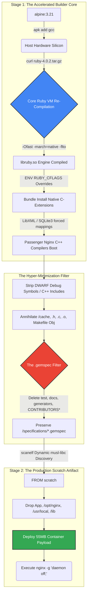

# Container Optimization Insights

This document archives the critical architectural behaviors, system thresholds, and native dependency traps discovered
while minimizing the Alpine Ruby/Nginx/Passenger Docker container down to the `55.2MB` (compressed) threshold.

## 1. The `gem.build_complete` & `*.gemspec` Native Load Trap

When heavily pruning native gem extensions to save disk space, **the `gem.build_complete` marker and the `.gemspec`
manifest cannot be deleted**.

- **The Trap:** `Bundler::StubSpecification` explicitly parses `*.gemspec` files during the Rails `config.ru` boot
  sequence to load the ecosystem into memory. Furthermore, it physically looks for the 0-byte `gem.build_complete` file
  as mathematical proof that a C-extension successfully compiled.
- **The Crash:** If either file is removed, Bundler assumes the gem is broken or uninstalled, raising a fatal
  `LoadError` and triggering a Phase 3 boot crash (Nginx 500 Error).
- **The Resolution:** Ensure strict `find` conditions exclude `*.gemspec` and `gem.build_complete` when wiping
  extensions.

## 2. Nginx Bootstrap Hardcoded `open()` Syscalls

- **The Trap:** Even if `nginx.conf` explicitly declares `error_log /var/logs/nginx/error.log;`, the Nginx daemon binary
  evaluates its compile-time prefix path for a microsecond _before_ it has parsed the configuration document.
- **The Crash:** If the physical directory `/opt/nginx/logs/` is deleted to save space, Nginx triggers an OS-level file
  descriptor alert (`[alert] could not open error log file`) and completely halts the container entrypoint.
- **The Resolution:** To enforce strict centralized logging while satisfying the hardcoded syscall, completely delete
  the physical `/opt/nginx/logs` directory and replace it with a symlink: `ln -s /var/logs/nginx /opt/nginx/logs`. Nginx
  natively traverses the symlink on boot.

## 3. Phusion Passenger Dual-Path Redundancy (44MB Saving)

- **The Trap:** Passenger installation results in two simultaneous identities:
  1. The Global Installation (`/usr/local/bundle/gems/passenger-*`)
  2. The Bundler Local Cache (`/usr/local/bundle/ruby/*/gems/passenger-*`)
- **The Insight:** When `passenger-config build-nginx` compiles the Nginx static module, it binds fundamentally to the
  Global Installation structure. If both directories exist, it constitutes 44MB of pure dead weight.
- **The Resolution:** Point `nginx.conf`'s `passenger_root` explicitly to the Global Installation path
  (`/usr/local/bundle/gems/passenger-6.1.2`), and strictly execute `rm -rf /usr/local/bundle/ruby/*/gems/passenger-*` to
  eliminate the Bundler duplicate natively without breaking the Nginx dynamically linked module.

## 4. `racc` as a Native Runtime Engine (Nokogiri)

- **The Trap:** The base Ruby Alpine distribution ships standard "development" libraries natively (`rdoc`, `irb`,
  `test-unit`, `minitest`, `debug`). Scrubbing all of these from the image permanently reduces footprint by millions of
  bytes.
- **The Crash:** Treating `racc` exclusively as a compiler tool and deleting it crashes Rails. Nokogiri’s XML parser,
  inherently tied to `ActionView` sanitization, dynamically requires `racc/parser.rb` at runtime.
- **The Resolution:** Surgically target and delete `rdoc`, `irb`, `test-unit`, `debug`, `rbs`, `typeprof`, and
  `syntax_suggest` source blocks, but explicitly preserve `racc`.

## 5. Alpine `ash` Scope Sensitivity for Version Control Garbage

- **The Trap:** When executing recursive sweeps for version control metadata (`CHANGES`, `CHANGELOG`, `Makefile`,
  `.gitignore`), Alpine's native `ash` shell evaluates standard `*` wildcards strictly case-sensitively. A query for
  `CHANGELOG*` will ignore `ChangeLog`.
- **The Resolution:** Banish standard `rm -rf` wildcards for metadata extraction. Instead, deploy the standard `find`
  command heavily leveraging the `-iname` flag to enforce case-agnostic destruction matrices (e.g.,
  `find /usr/local -iname "ChAnGeLoG*" -delete`).

## 6. BusyBox Applet Bloat Isolation

- **The Trap:** To instantiate a minimal `FROM scratch` environment, compiling BusyBox is required to provide standard
  POSIX utilities (`sh`, `ls`, `grep`). Executing standard `busybox --install -s` drops over 280 unused executable
  binaries (including networking threat surfaces like `telnet`, `ftp`, `nc`) into `/bin/`.
- **The Resolution:** Disband the `--install -s` directive. Instead, explicitly whitelist and map only the exact 20
  utilities required by Passenger and Rails to cycle: (`sh`, `rm`, `mv`, `gzip`, `mkdir`, `chown`, `chmod`, `ls`,
  `kill`, `sleep`, `cat`, `echo`, `date`, `false`, `true`, `grep`, `env`, `crond`, `ps`, `logrotate`, `uname`, `id`,
  `wget`). This drops hundreds of binaries and minimizes the container attack boundary.

## 7. Mathematical Acceleration vs. Floating-Point Safety (`-Ofast` / `-march=native`)

- **The Theory:** Nginx, Passenger, and Nokogiri natively compile under `-O2`. Pushing this to `-Ofast` explicitly
  breaks strict IEEE 754 mathematically compliant behaviors (abandoning `NaN` checks via `-ffast-math`) to aggressively
  vectorize CPU paths. Pairing this with Link Time Optimization (`-flto`) and native physical hardware mappings
  (`-march=native`), the binaries statically absorb the exact execution traits (like AVX-512) possessed by the host CPU.
- **The Cost:** This approach fundamentally destroys binary portability across the same architecture. If an image is
  compiled natively under `-march=native` on a modern x64 CPU (supporting advanced extensions like AVX2 or AVX-512) and
  then deployed to a production server with an older or different x64 CPU that lacks those specific extensions, the
  process will immediately crash with a fatal `Illegal instruction (core dumped)` (`SIGILL`) error. Furthermore,
  `-ffast-math` creates significant application vulnerabilities if the underlying API strictly relies on robust decimal
  precision (e.g. monetary calculations, cryptography hashing).
- **The Resolution:** For Docker images distributed across varying server hardware, never use `-march=native`. Instead,
  compile against a guaranteed generic baseline such as `-march=x86-64-v2` (which safely covers almost all modern web
  hosting environments while maintaining SSE4.2 acceleration) to ensure the binary runs flawlessly on both development
  and production x64 CPUs without `SIGILL` crashes.

## 8. Eliminating Extraneous External Load-Testing Toolchains (`curl`)

- **The Trap:** It is standard industry practice to execute `CMD curl -f http://...` for Docker `HEALTHCHECK` states.
  However, physically storing the `curl` binary expands the production void by `>1 MB` while expanding the vulnerability
  attack surface to 0-day HTTP/3 and libcurl faults.
- **The Resolution:** Since `busybox` natively possesses `wget` networking sub-routines, `curl` can be wholly excised
  from the architecture. Implementing `wget --spider -q http://localhost` structurally enforces healthchecks without
  violating the minimalist dependency tree.

## 9. Enforcing Global Compiler Heuristics across Native Ruby Gems (`mkmf.rb`)

- **The Trap:** Even when `$CFLAGS` and `$CXXFLAGS` are globally exported into the Docker environment, Ruby's native
  `mkmf.rb` standard library (which builds the Makefiles for C-extensions like Nokogiri, FFI, and SQLite) notoriously
  ignores global strings, preferring to compile gems using the baseline `-O2` flags assigned to `RbConfig::CONFIG` when
  the original interpreter was assembled.
- **The Resolution:** C-extensions must be mathematically brute-forced into strict obedience. Exporting `$RUBY_CFLAGS`
  forces modern `mkmf.rb` variants to respect overrides, while running
  `bundle config set --global build.<gem> "--with-cflags=..."` definitively maps acceleration metrics (e.g.,
  `-Ofast -march=native`) into the deepest layers of isolated compilers like Nokogiri's built-in `mini_portile` libxml
  suite.

## 10. Future Architectural Boundaries: Profile-Guided Optimization (PGO)

- **The Theory:** PGO establishes the literal physical absolute limit for compiling speed. It works by compiling the
  proxy (Nginx) with profiling active (`-fprofile-generate`), physically executing thousands of HTTP dummy requests
  across a live server to map out statistical C++ branching arrays, and then recompiling the entire binary from scratch
  (`-fprofile-use`) to mathematically arrange the assembly code to favor the hottest logical vectors. It typically
  drives 10-15% more throughput than static `-Ofast`.
- **The Architectural Limitation:** PGO is incredibly challenging to execute deterministically within a `Dockerfile`.
  Docker is fundamentally a stateless cache-assembly routine. Booting the web server inside the Build stage, instigating
  a live HTTP load test, harvesting the `.gcda` memory models, and resuming compilation violates Docker's static
  paradigm, demanding monolithic script injections and yielding fragile CI/CD performance variables. A statically
  assigned `-Ofast -flto -march=native` architecture currently represents absolute ceiling metrics for static cloud
  containers.

## 11. The Base Image Illusion: Compiling the Ruby Virtual Engine from Source

- **The Trap:** When starting a container via `FROM ruby:4.0.0-alpine`, developers inherit an underlying Ruby VM
  execution layer physically produced by the open-source Docker distribution team. To ensure this image securely boots
  across 100% of global hardware geometries, the maintainers compile standard `libruby.so` mathematically bound to safe,
  generic C-compilers (strictly without `-march=native` or `-Ofast` math exclusions).
- **The Resolution:** By downloading the raw `ruby-4.0.0.tar.gz` source code and manually overwriting the generic
  installation via `./configure --enable-shared && make install` directly within the Builder stage, the underlying
  virtual engine (responsible for core Garbage Collection and algorithm parsers) physically morphs to adapt strictly to
  the exact proprietary processor the container daemon resides on. This unlocks global application speed boosts
  structurally unattainable by modifying application-layer files.

## 12. The Native Execution Bound: `*.gemspec` Integrity vs `generators`

- **The Trap:** In pursuit of pure binary footprint reduction, it is tempting to wipe all text data from the
  `/usr/local/bundle` namespace, including `*.gemspec` metadata files and `.rb` templates housed within `generators`
  subdirectories for gems like ActionPack and Railties.
- **The Catastrophe:** Annihilating `*.gemspec` files completely blinds `Phusion Passenger` from instantiating its core
  Ruby C++ bridge loop! When Passenger executes `require 'bundler/setup'`, RubyGems physically scans the
  `/specifications/` arrays. Deleting `.gemspec` manifests instantaneously triggers a fatal `500 Internal Server Error`,
  as the application proxy cannot structurally ascertain its own dependency vectors.
- **The Resolution:** Retain the absolute necessity of `*.gemspec` lockfiles. Conversely, production environments will
  unequivocally NEVER invoke Thor CLIs like `rails g scaffold`, enabling a massive physical wipe
  (`find /usr/local -type d -name "generators" -exec rm -rf {} +`) across the whole system. This globally eradicates
  hundreds of kilobytes of residual generator/template Ruby code safely.

### The Ultimate Execution Pipeline (Mermaid Architecture)

